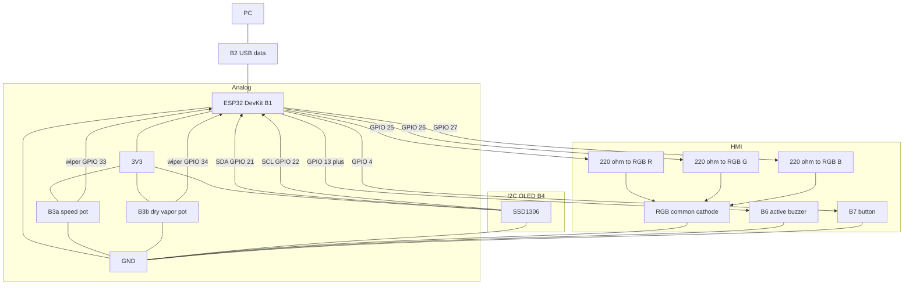
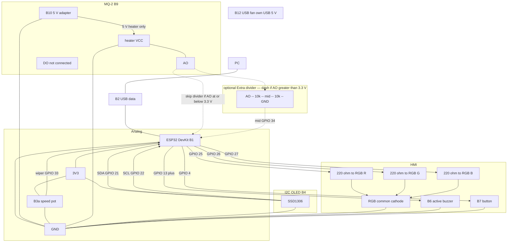
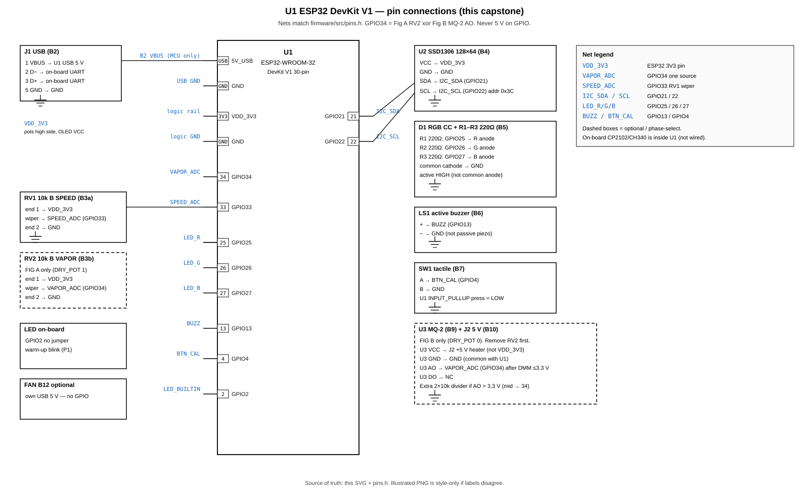
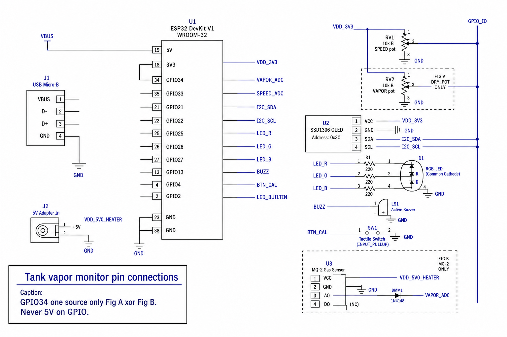
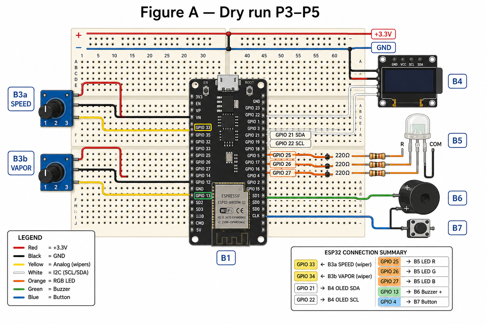
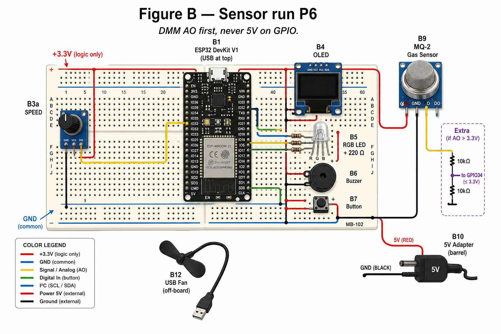

# Circuit diagram (connections)

Schematic nets for this capstone. **Pins must match** `firmware/src/pins.h` and `.cursor/skills/esp32-fuel-vapor/hardware.md`. How parts work: `docs/electronics-components.md`. Shop IDs: `docs/buy.md`.

Schematics are **Figure A / Figure B** (block + mermaid). **Pin connection schematic** is the KiCad-style sheet (each U1 pin named). Physical placement is **Breadboard connection**.

GPIO **34** has **one** source: dry vapor pot **or** MQ-2 AO. Two legal figures below.

---

## Shared rules

| Rule | Detail |
|------|--------|
| MCU power | USB data cable (B2) only. |
| Logic rail | ESP32 **3V3**: pots (high side), OLED VCC. |
| Heater rail | Adapter **5 V** (B10): MQ-2 VCC only. Never GPIO. Never ESP32 3V3. |
| Ground | **One** GND: USB, 3V3 return, pots, OLED, RGB cathode, buzzer −, button, MQ-2 GND, adapter GND. |
| Unused | MQ-2 **DO** open. Fan (B12) has **no** ESP32 pin. DMM (B11) is a tool, not a net. |
| RGB | Common **cathode** to GND; 220 Ω on each anode; GPIO active high. |

---

## Figure A — dry run (P3–P5)

`DRY_POT 1`. No MQ-2 heater. GPIO 34 = vapor **pot** wiper.



```
  PC --USB data B2--> ESP32 DevKit B1 -- 3V3 / GND --+
                                                    |
  3V3 --[B3a speed 10k]-- GND                       |
              wiper --> GPIO 33                     |
                                                    |
  3V3 --[B3b vapor 10k]-- GND                       |
              wiper --> GPIO 34                     |
                                                    |
  OLED B4: VCC=3V3  GND  SDA=21  SCL=22             |
                                                    |
  GPIO 25 --[220]-- R anode                         |
  GPIO 26 --[220]-- G anode -- common cathode -- GND|
  GPIO 27 --[220]-- B anode                         |
                                                    |
  GPIO 13 --> buzzer +     buzzer - --> GND         |
  GPIO 4  --> button       button   --> GND         |
  GPIO 2  = on-board LED (no jumper)                |
```

**Not on Figure A:** B9, B10, Extra divider, B12.

---

## Figure B — sensor run (P6+)

`DRY_POT 0`. **Remove** B3b from GPIO 34. MQ-2 heater on B10. Measure AO vs GND on DC V **before** tying AO to GPIO 34.



```
  PC --USB data B2--> ESP32 DevKit B1 -- 3V3 / GND --+
                                                    |
  3V3 --[B3a speed 10k]-- GND                       |
              wiper --> GPIO 33                     |
                                                    |
  B10 5 V --> MQ-2 VCC     MQ-2 GND --> common GND  |
  MQ-2 DO  = open                                   |
                                                    |
  MQ-2 AO ------------------------------------------+--> GPIO 34
       |                                            |   (direct path)
       |     - - - Extra, only if AO > 3.3 V - - -  |
       |                                            |
       +--[10 kΩ]--+--[10 kΩ]-- GND                 |
                   |                                |
                  mid ------------------------------+--> GPIO 34
                                                    |   (use mid, not both)
  OLED / RGB / buzzer / button: same as Figure A    |
                                                    |
  B12 fan: own USB 5 V, air at MQ-2, no GPIO        |
```

Dashed box = **Extra** 2× 10 kΩ. If DMM shows AO ≤ 3.3 V, use the **direct** AO → GPIO 34 wire and **omit** the divider. Never connect direct AO **and** divider mid to GPIO 34 together.

**Not on Figure B:** B3b on GPIO 34.

---

## Netlist (every wired part)

| ID | Terminal | Net / ESP32 | Figure |
|----|----------|-------------|--------|
| B1 | USB | B2 to PC | A, B |
| B1 | 3V3 | Logic rail | A, B |
| B1 | GND | Common GND | A, B |
| B1 | GPIO 33 | B3a wiper | A, B |
| B1 | GPIO 34 | B3b wiper **or** MQ-2 AO / divider mid | A xor B |
| B1 | GPIO 21 | OLED SDA | A, B |
| B1 | GPIO 22 | OLED SCL | A, B |
| B1 | GPIO 25 | 220 Ω → RGB red anode | A, B |
| B1 | GPIO 26 | 220 Ω → RGB green anode | A, B |
| B1 | GPIO 27 | 220 Ω → RGB blue anode | A, B |
| B1 | GPIO 13 | Buzzer `+` | A, B |
| B1 | GPIO 4 | Button | A, B |
| B1 | GPIO 2 | On-board LED | A, B (no jumper) |
| B2 | USB | PC ↔ DevKit | A, B |
| B3a | Ends | 3V3 and GND | A, B |
| B3a | Wiper | GPIO 33 | A, B |
| B3b | Ends | 3V3 and GND | **A only** |
| B3b | Wiper | GPIO 34 | **A only** |
| B4 | VCC, GND, SDA, SCL | 3V3, GND, 21, 22 | A, B |
| B5 | Common cathode | GND | A, B |
| B5 | R, G, B anodes | 220 Ω then 25, 26, 27 | A, B |
| B6 | `+` / `−` | GPIO 13 / GND | A, B |
| B7 | Pair | GPIO 4 and GND | A, B |
| B8 | Rails | Carry 3V3, GND; jumper splits | A, B |
| B9 | VCC | B10 5 V | **B only** |
| B9 | GND | Common GND | **B only** |
| B9 | AO | GPIO 34 or divider mid | **B only** |
| B9 | DO | Open | **B only** |
| B10 | +5 V / GND | MQ-2 VCC / common GND | **B only** |
| Extra | Two 10 kΩ | AO–mid–GND; mid = 34 | **B, dashed, if needed** |
| B11 | Probes | Not a permanent net | Bring-up |
| B12 | USB 5 V | Own supply | **B optional**; no GPIO |

OLED I²C address **0x3C** (try **0x3D**). RGB common **cathode** (confirm diode mode). Active buzzer, not passive piezo.

---

## Pin connection schematic

EDA-style sheet: **U1** is the DevKit (on-board USB-UART stays inside U1 — you do not wire a CP2102). Each used pin has a **net name**. Dashed boxes are phase-select (Fig A xor Fig B).

Regenerate the vector: `scripts\gen-pin-schematic.cmd`.



Illustrated sheet in the same drawing style (if a label on this PNG disagrees with the table, **trust the table and SVG**):



| U1 pin (silk) | Net | Connect to | Notes |
|---------------|-----|------------|--------|
| USB | `5V_USB` | J1 / B2 VBUS, D±, GND | MCU + UART only |
| **3V3** | `VDD_3V3` | RV1/RV2 high, U2 VCC | Not MQ-2 heater |
| **GND** | `GND` | All module GND, RGB K, LS1 −, SW1, J2 GND | One ground |
| **GPIO 34** | `VAPOR_ADC` | **Fig A:** RV2 wiper. **Fig B:** U3 AO (or Extra mid) | Input-only. One source. |
| **GPIO 33** | `SPEED_ADC` | RV1 wiper | `v` 0–120 km/h |
| **GPIO 21** | `I2C_SDA` | U2 SDA | |
| **GPIO 22** | `I2C_SCL` | U2 SCL | 0x3C (try 0x3D) |
| **GPIO 25** | `LED_R` | R1 220 Ω → RGB red anode | Active high |
| **GPIO 26** | `LED_G` | R2 220 Ω → RGB green anode | |
| **GPIO 27** | `LED_B` | R3 220 Ω → RGB blue anode | Spare / off |
| **GPIO 13** | `BUZZ` | LS1 `+` | JTAG strap (F-010) |
| **GPIO 4** | `BTN_CAL` | SW1; other side GND | `INPUT_PULLUP` |
| **GPIO 2** | `LED_BUILTIN` | On-board LED | No Dupont |
| — | `VDD_5V0_HEATER` | J2 +5 V → U3 VCC | Fig B only |

Designators: **U1** DevKit, **J1** USB B2, **RV1** speed, **RV2** dry vapor, **U2** OLED, **D1/R1–R3** RGB, **LS1** buzzer, **SW1** button, **U3** MQ-2, **J2** 5 V adapter.

---

## Breadboard connection

MB-102 style board (B8). The ESP32 **straddles the centre gap** so each header row sits in one column of holes. USB (B2) faces the **operator**. Dupont: **M–M** hole-to-hole; **M–F** onto OLED / MQ-2 / pot pins.

Typical **DOIT DevKit V1 30-pin** (USB at the **top** of the module). Confirm labels on **your** board.

| Header (USB at top) | Silk (top → bottom, typical) |
|---------------------|------------------------------|
| Left | `3V3`, `EN`, `VP`, `VN`, **34**, 35, 32, **33**, **25**, **26**, **27**, 14, 12, `GND`, **13** |
| Right | `VIN`, `GND`, 15, **2**, 0, **4**, 16, 17, 5, 18, 19, **21**, RX0, TX0, **22** |

GPIO **23** may be last on the right; unused here. Do **not** use `VIN` for the MQ-2 heater in this lab (heater = B10 5 V).

Pictures below are **placement guides**. Match GPIO **silk** on your DevKit. Jumper split power rails. Feed the red rail from ESP32 **3V3** and the blue rail from ESP32 **GND**. Never put B10 5 V on the 3V3 rail.

Suggested jumper colours: red = 3V3, black = GND, yellow = analog, white = I²C, orange = RGB, green = buzzer, blue = button.

### Figure A — breadboard (dry pots)

Leave space on the far right for the MQ-2 later. Each 10 kΩ pot uses three adjacent holes (ends + wiper).



| From (silk) | Dupont to |
|-------------|-----------|
| `3V3` | +3V3 rail (then pot end 1, OLED VCC) |
| `GND` | GND rail (then pot end 2, OLED GND, RGB common, buzzer −, button) |
| `33` | B3a **wiper** (centre pin) |
| `34` | B3b **wiper** |
| `21` / `22` | OLED SDA / SCL |
| `25` / `26` / `27` | 220 Ω then RGB R / G / B anodes |
| RGB long/common pin | GND rail |
| `13` | Buzzer `+` |
| `4` | One button pair; other pair to GND rail |

Resistors: each 220 Ω in series (GPIO hole → resistor → RGB anode). Do not short GPIO to the LED.

### Figure B — breadboard (MQ-2)

**Unplug** B3b from GPIO 34. Keep B3a. Park MQ-2 **off** the 3V3 rail. Measure AO vs GND on DC V before connecting GPIO 34.



**Dashed Extra:** two 10 kΩ; AO at the top, GND at the bottom, **mid → GPIO 34**. Do not also run a direct AO wire to 34. B12 fan uses its own USB 5 V (no GPIO).

### Breadboard checks

| Check | Pass |
|-------|------|
| Split rails jumpered | Continuity along each full + and − rail |
| 3V3 vs GND | DMM DC V ≈ 3.3 V with USB plugged |
| No 5 V on +3V3 rail | Heater only from B10 to MQ-2 VCC |
| GPIO 34 | One wiper **or** AO/mid, never both |
| ESP32 still USB-powered | B10 does not replace B2 |

---

## Do not connect

- 5 V to any GPIO or to OLED VCC.
- MQ-2 heater to ESP32 **3V3**.
- B3b and MQ-2 AO (or divider mid) on GPIO 34 at once.
- Direct AO and divider mid both to GPIO 34.
- Petrol or fuel vapour (skill safety).

---

## Build order

1. B1 + B2. Confirm COM port. On-board LED (P1).
2. Figure A: B3a, B3b, B4, B5, B6, B7 on the breadboard.
3. Figure B: remove B3b; DMM on B10 then MQ-2 AO; then AO or dashed divider to GPIO 34; `DRY_POT 0`.
4. Optional B12 aimed at the MQ-2, not at the ESP32 USB plug.

---

## Related files

| File | Role |
|------|------|
| `hardware.md` | Pins, BOM, bench do/do-not |
| `electronics-components.md` | Electrical behaviour |
| `buy.md` | Photos and DMM dial |
| `pins.h` | Firmware GPIO numbers |
