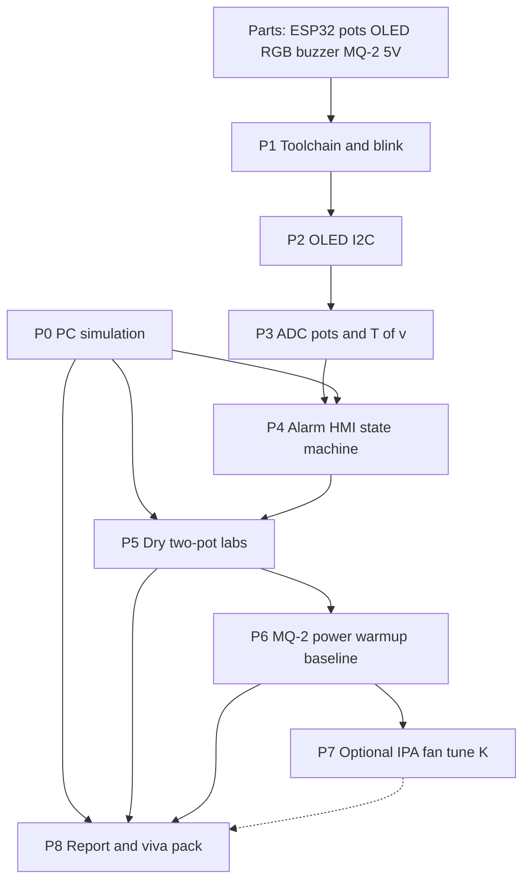

# Phase-wise implementation plan

ESP32 tank vapor monitor: adaptive `T(v)` vs speed. One MQ-2 (tank). Software sim, then dry pots, then sensor.

Do not start a later phase until that phase’s **Depends on** items are done, unless the table marks a track as parallel.

**Live status (refresh before commit):** `docs/phase-execution-status.md`. **What you type:** `docs/execution-plan.md` (`scripts\*.cmd`). Checklists below are the detailed ticks.

Overview: `docs/overview.md`. Architecture: `docs/architecture.md`. Mathematics: `docs/mathematics.md`. Pins: `.cursor/skills/esp32-fuel-vapor/hardware.md`. Experiments: `.cursor/skills/esp32-fuel-vapor/tests.md`. Faults (no fix without ID approval): `docs/fault-ledger.md`.

## Dependency graph

Solid arrows are required. P7 is optional; P8 can proceed from P5+P6 if P7 is skipped. P0 does not need hardware. **BUY** can run in parallel with P0.

Tick boxes as you finish. A phase is done only when **every item in its checklist** is checked **and** the exit criterion in the summary table is true.

## Progress

- [ ] **BUY** — parts on the desk (see BUY checklist)
- [x] **P0** — PC sim runs; re-tick after any `K` change
- [ ] **P1** — upload + blink
- [ ] **P2** — OLED text
- [ ] **P3** — live `d`, `v`, `T_mod`, `T_high` + serial
- [ ] **P4** — RGB / buzzer / hysteresis match sim
- [ ] **P5** — dry tables filled
- [ ] **P6** — MQ-2 air-only, `DRY_POT 0`
- [ ] **P7** — skipped **or** IPA/fan/`K` recorded (optional)
- [ ] **P8** — report + demo pack

## BUY checklist (parallel with P0)

- [ ] ESP32 DevKit (USB cable that actually enumerates)
- [ ] Two 10 kΩ potentiometers
- [ ] SSD1306 128×64 I²C OLED
- [ ] Common-cathode RGB LED (or three LEDs) + ~220 Ω resistors
- [ ] Active buzzer
- [ ] Tactile button
- [ ] Breadboard + Dupont wires
- [ ] MQ-2 module (needed by P6, buy early)
- [ ] 5 V adapter for MQ-2 heater (not ESP32 3V3)
- [ ] DMM (AO ≤ 3.3 V check before GPIO 34)
- [ ] USB fan (optional, P7)
- [ ] Pin map printed or open: `.cursor/skills/esp32-fuel-vapor/hardware.md`

## Phase summary

| ID | Name | Depends on | Parallel with | Exit criterion |
|----|------|------------|---------------|----------------|
| P0 | PC simulation of `T(v)` | — | BUY, P1–P2 | `scripts\p0.cmd` prints MOD→SAFE on speed sweep at `d=200`; CSV in `sim/out/` |
| P1 | Toolchain + blink | BUY (ESP32 + USB) | P0 | `pio run -t upload`; on-board LED blinks |
| P2 | OLED | P1 | P0 | OLED shows a fixed test string; fail path if `0x3C` missing |
| P3 | ADC + `T(v)` on display | P2, two 10 kΩ pots | P0 | OLED shows live `d`, `v`, `T_mod`, `T_high`; serial CSV at ~2 Hz |
| P4 | Alarm state machine | P3, P0 (same constants) | — | RGB + buzzer follow SAFE/MOD/HIGH; hysteresis; sim and board agree at the same `d`, `v` |
| P5 | Dry lab tables | P4, P0 | — | Filled tables: speed sweep at fixed `d`; delta sweep at 0 and 80 km/h |
| P6 | MQ-2 on 5 V | P5, 5 V supply, AO ≤ 3.3 V | — | 60 s warm-up, baseline, speed-only sweep stays SAFE if `d ≈ 0`; `DRY_POT 0` |
| P7 | Optional chemistry / fan / tune `K` | P6 | — | Optional IPA (no petrol) and/or fan; `K` updated in **firmware and sim together** |
| P8 | Report + viva | P0, P5, P6 (P7 if done) | — | Overview + plots + limitations + pin map; demo script |

## Tracks

| Track | Phases | Notes |
|-------|--------|--------|
| Algorithm / math | P0 → P4, P5, P8 | Closed-form `T(v)`, inverses; no MCU |
| Bring-up | P1 → P2 → P3 → P4 | Firmware + breadboard |
| Evidence | P5 → P6 → P7 | Measurements |
| Submit | P8 | Uses sim CSV + bench tables |

## P0 — PC simulation

**Goal:** Predicted trip points and closed-form `T(v)` math before wiring.

**Depends on:** nothing. **Already in repo:** yes — re-run after any `K` change.

**Checklist**

- [x] `scripts\p0.cmd` runs on Windows
- [x] Constants match `firmware/src/math_params.h` (not copied ad hoc in `main.cpp`)
- [x] Closed form printed: `v_enter`, `v_leave`, `H/K_MOD`, `d_enter` at 0 and 80 km/h
- [x] Speed sweep at `d=200` shows **MOD → SAFE** (leave MOD when `d < T_mod - H`)
- [x] Delta sweep at `v=0` vs `v=80`: trip delta is **higher** at 80 km/h
- [x] CSV written: `sim/out/sim_speed_sweep_d200.csv`, `sim_delta_sweep_v0.csv`, `sim_delta_sweep_v80.csv`
- [x] `sim/out/math_summary.txt` written by `scripts\p0.cmd` (P8 snippet)
- [ ] Can derive `v_leave(200)=75` km/h by hand (`docs/mathematics.md` §5)

**Exit:** Closed-form and sweeps done; report screenshot and hand derivation can wait for P8.

## P1 — Toolchain and blink

**Goal:** Flashing works.

**Depends on:** ESP32 DevKit (USB).

**Checklist**

- [ ] PlatformIO CLI or VS Code PlatformIO installed
- [ ] `firmware/` env `esp32dev` builds (`pio run`)
- [ ] Board enumerates over USB
- [ ] `pio run -t upload` succeeds
- [ ] On-board LED (GPIO 2) blinks
- [ ] Serial port identified (COM number noted)

**Exit:** Upload + LED.

## P2 — OLED (I²C)

**Goal:** Operator display path.

**Depends on:** P1, OLED module.

**Checklist**

- [ ] Wiring: SDA **21**, SCL **22**, 3V3, GND (common with ESP32)
- [ ] Adafruit SSD1306 + GFX in `platformio.ini` / `.pio` libs
- [ ] OLED shows a readable test string
- [ ] Address confirmed (`0x3C`, or `0x3D` if scan required)
- [ ] If OLED unplugged: serial prints an error; firmware does not hang forever

**Exit:** Text on screen or documented fail path.

## P3 — Pots, ADC, `T(v)`

**Goal:** Independent variable (speed) and vapor index on ADC1.

**Depends on:** P2, two pots. **Not** MQ-2.

**Checklist**

- [ ] Speed pot: 3V3 — wiper — GND, wiper to **GPIO 33**
- [ ] Vapor pot: same, wiper to **GPIO 34** (MQ-2 **not** on this pin)
- [ ] `DRY_POT` is `1` in `firmware/src/pins.h`
- [ ] ADC averaged (not a single sample); attenuation 11 dB
- [ ] OLED live: `d`, `v` (0–120 km/h), `T_mod`, `T_high`
- [ ] Holding vapor pot still: turning **speed** pot changes `T` on OLED
- [ ] Holding speed still: turning **vapor** pot changes `d`
- [ ] Serial ~2 Hz: `t_ms,raw,baseline,delta,speed,Tmod,Thigh,state`

**Exit:** Both pots proven on OLED + serial.

## P4 — State machine and HMI

**Goal:** Same rule as the sim, on GPIO.

**Depends on:** P3; P0 (same constants).

**Checklist**

- [ ] `T_MOD_0`, `K_*`, hysteresis in `main.cpp` **equal** the Python sim
- [ ] Short dry warm-up then baseline captured
- [ ] Calibrate button (GPIO 4, pull-up) recaptures baseline
- [ ] RGB: green SAFE, yellow MOD (R+G), red HIGH (common-cathode unless hardware.md says otherwise)
- [ ] Buzzer: off / intermittent (`millis()` cadence) / continuous — **no** `delay()` for beep timing
- [ ] At `d ≈ 200`, raising speed **clears MOD toward SAFE** (same as sim)
- [ ] Serial `state` matches sim at 2–3 checkpoints (e.g. `v=0, d=200`; `v=80, d=200`; `v=0, d=500`)

**Exit:** HMI + numbers agree with P0.

## P5 — Dry two-pot labs

**Goal:** Report tables without gas.

**Depends on:** P4 and P0.

**Checklist**

- [ ] Experiment 1 (`tests.md`): fixed `d ≈ 200`, sweep `v = 0, 40, 80, 120`
- [ ] Table filled: `v`, `T_mod`, `T_high`, `d`, state
- [ ] OLED photographed at 0, 60 or 80, and 120 km/h
- [ ] Experiment 2: sweep vapor at **0 km/h**; note `d` at green→yellow and yellow→red
- [ ] Experiment 2 repeated at **80 km/h**; those trip `d` values are **higher**
- [ ] Serial log saved (Notepad/CSV) next to sim CSV for P8
- [ ] Compared at least one row to `sim/out/` (same `d`, `v`)

**Exit:** Both tables complete; speed raises the trip point.

## P6 — MQ-2 hardware

**Goal:** Real tank-zone sensor, still no petrol.

**Depends on:** P5; 5 V supply; MQ-2.

**Checklist**

- [ ] Vapor pot **removed** from GPIO 34 (never parallel with AO)
- [ ] MQ-2 heater VCC on **external 5 V**; ESP32 3V3 not used for heater
- [ ] Common GND: 5 V brick, ESP32, MQ-2, remaining speed pot
- [ ] DMM: AO vs GND; if AO can exceed 3.3 V, divider fitted
- [ ] AO → GPIO 34
- [ ] `DRY_POT` set to `0`; 60 s warm-up observed on OLED
- [ ] Calibrate in **clean air**; `d` near 0
- [ ] Experiment 3: speed pot only — `T` moves; state stays **SAFE**
- [ ] No petrol / no fuel tank / no vehicle

**Exit:** Speed does not fake a leak; `T(v)` still visible.

## P7 — Optional: IPA, fan, tune `K`

**Goal:** Physical airflow / vapor anecdote; constant fit.

**Depends on:** P6. **Allowed to skip:** tick the skip box and go to P8.

**Checklist**

- [ ] **Skip P7** — not doing chemistry/fan this round
- [ ] **Or** USB fan aimed at MQ-2 (not at ESP32); delta change noted
- [ ] **Or** brief IPA **far** from PCB; bottle closed after; delta noted at `v=0`
- [ ] If `K` or `T_0` changed: `main.cpp` **and** `sim/adaptive_threshold.py` updated together; P0 re-run
- [ ] Confirm: **no petrol**, no lighter in a closed room, no soaking the sensor

**Exit:** Skip **or** one recorded run (+ synced constants if tuned).

## P8 — Report and viva

**Goal:** Course submission pack.

**Depends on:** P0, P5, P6; P7 if performed (not skipped).

**Checklist**

- [ ] `docs/architecture.md` cited (L0–L5); `docs/mathematics.md` equations (4)–(5) and §5 inverses in the write-up
- [ ] `docs/overview.md` current (one MQ-2, adaptive `T(v)`, sim + pots)
- [ ] This plan + pin map (`hardware.md`) attached or cited
- [ ] Sim **closed-form** printout + CSV plot from `sim/out/`
- [ ] Predicted vs measured `d_enter(0)` and `d_enter(80)` (math vs pots)
- [ ] P5 dry tables + OLED photos
- [ ] P6 air-only result (speed sweep, SAFE)
- [ ] P7 results **or** explicit “not performed”
- [ ] Limitations written: MQ-2 not petrol-specific; speed is a pot; not certified
- [ ] Safety sentence: bench only, no fuel
- [ ] 2-minute demo: equation → sim numbers → two pots → MQ-2 air
- [ ] `DRY_POT` value for the **demo build** known (0 vs 1)

**Exit:** Faculty can follow the demo without a localization story.

## What not to put on the critical path

- Second/third MQ-2 (localization).
- Wi-Fi / phone app.
- GPS or real vehicle speed.
- Wokwi (optional extra, not a phase gate).
- In-vehicle or fuel-tank tests.

## Suggested calendar (adjust to your deadline)

| Week | Focus |
|------|--------|
| 1 | P0 + BUY; P1–P2 when the board arrives |
| 2 | P3–P5 |
| 3 | P6; P7 if time; P8 write-up |

P0 in week 1 means you still have figures if hardware is late.
